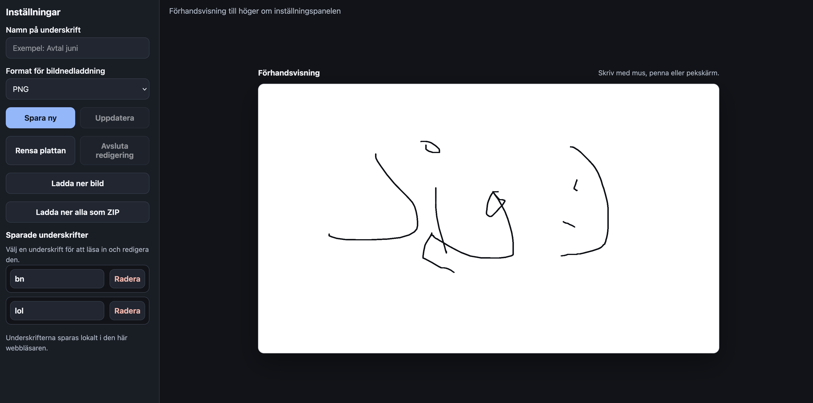

# Elektroniska Signaturer

En webbapp på 25kb som låter dig skapa din personliga elektroniska signatur med mus, penna eller liknande touch device och som sparar i IndexedDB, låter dig ladda ner enskilda signaturer, eller alla som ZIP-fil.

## Ändringar för filnamn m.m.
Ändra raden i `saveNew()` där posten skapas:
`name: nameInput.value.trim() || "Underskrift",`till `name: nameInput.value.trim(),`

Då sparas exakt det angivna namnet, utan standardtexten ”Underskrift”. Om fältet lämnas tomt sparas namnet som en tom sträng. Gör samma ändring i `updateActive()` om du vill att uppdateringar också ska tillåta ett tomt namn: `record.name = nameInput.value.trim();`

I `downloadZip()` ändrar du raden som skapar filnamnet: name: `safeFilename(record.name) + "-" + record.id.slice(0, 8) + ".png",` till `name: safeFilename(record.name) + ".png",` Då blir filen exempelvis `Avtal_juni.png`. Om flera sparade underskrifter har samma namn får de samma filnamn i ZIP-arkivet, vilket kan orsaka konflikter.
